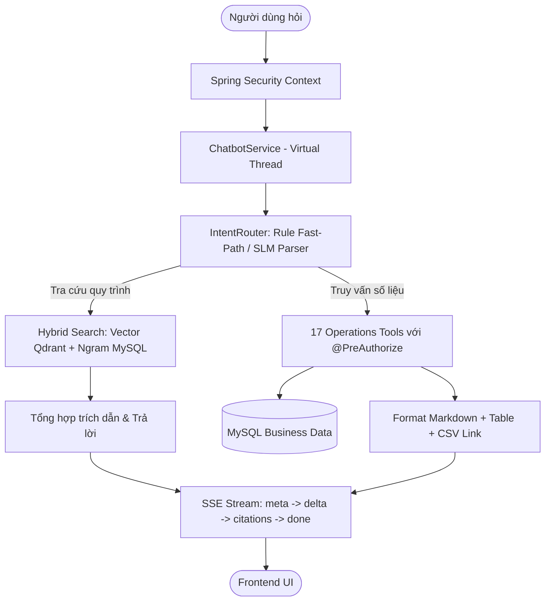

# 🏪 Supermarket Management System - Backend Core

> **Hệ thống Quản lý Siêu thị Toàn diện & Trợ lý ảo RAG Thông minh**  
> Dự án Chuyên ngành Kỹ thuật Phần mềm (CNPMTT) – ThS CNTT.

[](https://spring.io/projects/spring-boot)
[](https://openjdk.org/)
[](https://www.mysql.com/)
[](https://flywaydb.org/)
[](https://qdrant.tech/)
[](https://ollama.com/)

---

## 📑 Mục lục
1. [Giới thiệu](#-giới-thiệu)
2. [Công nghệ sử dụng (Tech Stack)](#-công-nghệ-sử-dụng-tech-stack)
3. [Kiến trúc hệ thống & Tính năng cốt lõi](#-kiến-trúc-hệ-thống--tính-năng-cốt-lõi)
4. [Hệ thống Trợ lý ảo RAG & Tool Calling](#-hệ-thống-trợ-lý-ảo-rag--tool-calling)
5. [Cấu hình môi trường (.env)](#-cấu-hình-môi-trường-env)
6. [Hướng dẫn cài đặt & Khởi chạy](#-hướng-dẫn-cài-đặt--khởi-chạy)
7. [Hướng dẫn Cài đặt & Cấu hình Ollama (SLM Router)](#-hướng-dẫn-cài-đặt--cấu-hình-ollama-slm-router)
8. [Database & Flyway Migrations](#-database--flyway-migrations)
9. [Kiểm thử tự động (Testing)](#-kiểm-thử-tự-động-testing)

---

## 📖 Giới thiệu

`Supermarket-Management` là backend trung tâm của hệ thống quản lý siêu thị hiện đại, cung cấp đầy đủ các API RESTful nghiệp vụ bán hàng, quản lý chuỗi kho, luồng hàng hóa, nhân sự, kiểm kê, báo cáo doanh thu, cùng hệ thống **Trợ lý nội bộ tích hợp AI (Enterprise Hybrid RAG Assistant)** giúp nhân viên tra cứu nhanh quy trình vận hành và số liệu kinh doanh theo thời gian thực với phân quyền nghiêm ngặt.

Hệ thống được thiết kế theo kiến trúc chuẩn mực: **Clean Architecture / Layered Service**, áp dụng tính năng **Virtual Threads (Project Loom)** cho hiệu năng xử lý đồng thời vượt trội và tối ưu hóa tài nguyên phần cứng.

---

## 🛠 Công nghệ sử dụng (Tech Stack)

| Thành phần | Công nghệ / Thư viện | Vai trò |
| :--- | :--- | :--- |
| **Platform** | Java 26 (OpenJDK) | Nền tảng thực thi với Project Loom Virtual Threads |
| **Framework** | Spring Boot 4.1.1 | Web REST API, DI Container, Configuration |
| **Bảo mật** | Spring Security & OAuth2 JWT | Xác thực, phân quyền RBAC & Method Security `@PreAuthorize` |
| **ORM / Database** | Spring Data JPA (Hibernate 7.4) | Truy vấn cơ sở dữ liệu, EntityManager, Specifications |
| **RDBMS** | MySQL 9.7 (utf8mb4_unicode_ci) | Lưu trữ nghiệp vụ, giao dịch ACID, Ngram Fulltext Index |
| **Database Migration** | Flyway 10 | Quản lý phiên bản schema tự động theo thứ tự |
| **Vector Database** | Qdrant v1.20 | Lưu trữ và tìm kiếm vector embedding đoạn văn bản quy trình |
| **AI / SLM Router** | Ollama (`qwen2.5:0.5b`) | Nhận diện ý định và phân giải tham số câu hỏi tiếng Việt |
| **Tài liệu & Parsing** | Apache PDFBox, JSoup | Bóc tách nội dung tri thức từ file PDF, HTML, TXT, MD |
| **Tiện ích code** | Lombok, MapStruct | Giảm thiểu boilerplate code, ánh xạ DTO ↔ Entity |
| **Testing** | JUnit 5, Mockito, AssertJ | Kiểm thử đơn vị & kiểm thử tích hợp (101 unit tests) |

---

## 🏛 Kiến trúc hệ thống & Tính năng cốt lõi

### 1. Phân quyền người dùng (RBAC)
- **ADMIN**: Quản trị toàn hệ thống, cấu hình tham số, quản lý người dùng, phân quyền vai trò.
- **MANAGER**: Giám sát hoạt động siêu thị, quản lý kho, xem toàn bộ báo cáo doanh thu, quản lý danh mục tri thức AI.
- **STOREKEEPER (Thủ kho)**: Quản lý nhập/xuất kho, điều chuyển kho nội bộ, kiểm kê định kỳ, theo dõi hạn sử dụng theo lô.
- **SALESMAN (Thu ngân/Bán hàng)**: Tạo hóa đơn bán lẻ, áp dụng khuyến mãi, tích điểm thành viên, xử lý đổi trả hàng hóa, hoàn thành checklist ca làm việc.

### 2. Các phân hệ nghiệp vụ chính
- **Bán hàng & Thu ngân (POS)**: Lập hóa đơn siêu tốc, quét barcode, tính toán chiết khấu, tự động sinh mã hóa đơn (`HD00001`).
- **Quản lý Đổi/Trả hàng (Sales Return)**: Hỗ trợ hoàn trả toàn phần hoặc một phần, hoàn lại tiền và cập nhật tồn kho tự động theo chính sách.
- **Quản lý Đa Kho & Tồn kho**: Theo dõi tồn kho theo từng kho hàng, cảnh báo mức tồn tối thiểu, báo cáo xuất-nhập-tồn.
- **Quản lý Hạn dùng theo Lô (FEFO/FIFO)**: Theo dõi số lô (`lotNumber`), hạn sử dụng (`expiryDate`), cảnh báo hàng cận date (7, 30, 90 ngày).
- **Kiểm kê & Điều chuyển**: Lập phiếu kiểm kê kho, cân bằng kho tự động; lập phiếu chuyển hàng giữa các kho chi nhánh.
- **Báo cáo & Thống kê**: Doanh thu theo thời gian, theo chi nhánh kho, theo nhân viên xuất sắc; xuất báo cáo CSV trực tiếp.

---

## 🤖 Hệ thống Trợ lý ảo RAG & Tool Calling

Trợ lý ảo nội bộ sử dụng kiến trúc **Enterprise Hybrid RAG (Retrieval-Augmented Generation)** kết hợp **Tool Calling**:



### 17 Công cụ nghiệp vụ (Chat Tools):
1. `revenue`: Thống kê doanh thu theo mốc thời gian (hôm nay, tháng này, khoảng ngày).
2. `top_products`: Danh sách sản phẩm bán chạy nhất theo số lượng và doanh thu.
3. `sales_by_employee`: Báo cáo xếp hạng doanh số bán hàng của nhân viên.
4. `inventory`: Tra cứu tổng quan tồn kho, lọc theo kho hoặc mặt hàng sắp hết.
5. `expiring_lots`: Báo cáo các lô hàng sắp hết hạn trong 7, 30, 90 ngày tới.
6. `product_lookup`: Tra cứu chi tiết sản phẩm, giá bán, tồn khả dụng theo tên/mã/barcode.
7. `invoice_lookup`: Tra cứu chi tiết một mã hóa đơn cụ thể như HD000001.
8. `sales_return_lookup`: Tra cứu phiếu trả hàng theo mã TH000001.
9. `my_shift_summary`: Thống kê doanh thu và số hóa đơn đã lập trong ca làm việc hiện tại.
10. `customer_lookup`: Tra cứu thông tin khách hàng, số điện thoại, điểm tích lũy.
11. `supplier_lookup`: Tra cứu nhà cung cấp, thông tin liên hệ và công nợ.
12. `employee_lookup`: Tra cứu thông tin nhân viên, vị trí và trạng thái làm việc.
13. `warehouse_lookup`: Danh sách và địa chỉ các kho hàng trong hệ thống.
14. `promotion_lookup`: Tra cứu các chương trình khuyến mãi đang áp dụng.
15. `shift_checklist`: Báo cáo checklist công việc cần thực hiện trong ca.
16. `current_user`: Xem thông tin tài khoản và quyền hạn của người dùng đang đăng nhập.
17. `invoice_search` & `sales_return_search`: Tìm kiếm nâng cao danh sách hóa đơn và phiếu trả hàng.

---

## ⚙ Cấu hình môi trường (.env)

Tạo file `.env` tại thư mục gốc `Supermarket-Management/.env` từ file mẫu [.env.example](file:///d:/Profile/ThS/Class/CNPMTT/Project/Supermarket-Management/.env.example):

```properties
# ==========================================================
# CẤU HÌNH BẢO MẬT & DATABASE
# ==========================================================
JWT_SECRET_KEY=9a8b7c6d5e4f3a2b1c0d9e8f7a6b5c4d3e2f1a0b9c8d7e6f5a4b3c2d1e0f9a8b
DBMS_CONNECTION=jdbc:mysql://localhost:3306/supermarket_management?useSSL=false&allowPublicKeyRetrieval=true&serverTimezone=UTC
DBMS_USERNAME=root
DBMS_PASSWORD=your_mysql_password

# Tài khoản Admin mặc định khi khởi tạo DB
ADMIN_USERNAME=admin1234
ADMIN_PASSWORD=Admin@123456
EMPLOYEE_DEFAULT_PASSWORD=Employee@123

# Địa chỉ Frontend kết nối
ORIGIN_CLIENT_1=http://localhost:4200

# ==========================================================
# CẤU HÌNH CHATBOT RAG & VECTOR DB
# ==========================================================
QDRANT_URL=http://localhost:6333
QDRANT_API_KEY=
QDRANT_COLLECTION=kb_chunks

# Tùy chọn Embedding Model (Ollama / TEI) - Để trống nếu dùng Ngram MySQL
EMBEDDING_URL=
EMBEDDING_MODEL=

# Tùy chọn Bộ phân tích ngôn ngữ tự nhiên SLM Router (Ollama)
SLM_ENABLED=false
SLM_URL=http://localhost:11434
SLM_MODEL=qwen2.5:0.5b
SLM_TIMEOUT_MS=3000
```

---

## 🚀 Hướng dẫn cài đặt & Khởi chạy

### Yêu cầu tiên quyết
- **JDK 26** hoặc **JDK 21+** (Khuyên dùng OpenJDK với hỗ trợ Virtual Threads).
- **Maven 3.9+**
- **MySQL 8.0+ / 9.0+**
- **Docker & Docker Compose** (để chạy Qdrant và Ollama nếu cần).

### Cách 1: Chạy trực tiếp từ mã nguồn

1. **Khởi chạy cơ sở dữ liệu MySQL** và đảm bảo database `supermarket_management` đã sẵn sàng.
2. **Khởi chạy Qdrant** (nếu dùng tìm kiếm vector):
   ```bash
   docker run -d -p 6333:6333 -v qdrant_storage:/qdrant/storage qdrant/qdrant:v1.20.0
   ```
3. **Cài đặt dependencies và khởi chạy Backend**:
   ```bash
   cd Supermarket-Management
   mvn clean spring-boot:run
   ```
4. Hệ thống sẽ khởi chạy tại: `http://localhost:9999/api/v1`

### Cách 2: Chạy toàn bộ với Docker Compose

Tại thư mục `Supermarket-Management`:
```bash
docker compose up -d --build
```

---

## 🦙 Hướng dẫn Cài đặt & Cấu hình Ollama (SLM Router)

Hệ thống tích hợp mô hình ngôn ngữ nhỏ **Small Language Model (SLM)** chạy cục bộ qua **Ollama** (`qwen2.5:0.5b`). Mô hình này chỉ nặng **~398MB** và tốn **~500MB RAM**, giúp phân tích câu hỏi tự nhiên tiếng Việt phức tạp thành JSON gọi Tool chính xác mà không cần hardcode từ khóa.

> [!NOTE]
> Khi Ollama tắt hoặc không khả dụng, hệ thống **tự động fallback 100% mượt mà** sang bộ phân giải quy tắc xác định `IntentRouter`, đảm bảo chatbot không bao giờ bị gián đoạn.

### Bước 1: Cài đặt Ollama

#### Lựa chọn A: Cài đặt trực tiếp trên máy (Khuyên dùng)
- **Windows**:
  - Tải bộ cài chính thức: [https://ollama.com/download/OllamaSetup.exe](https://ollama.com/download/OllamaSetup.exe) (hoặc qua dòng lệnh: `winget install Ollama.Ollama`).
  - Cài đặt bình thường. Ollama sẽ tự động khởi chạy dưới khay hệ thống (System Tray).
- **macOS / Linux**:
  ```bash
  curl -fsSL https://ollama.com/install.sh | sh
  ```

#### Lựa chọn B: Chạy qua Docker
```bash
docker run -d -p 11434:11434 -v ollama_storage:/root/.ollama --name ollama ollama/ollama:latest
```

---

### Bước 2: Tải mô hình SLM (`qwen2.5:0.5b`)

Mở Terminal / PowerShell và chạy lệnh sau để tải mô hình:

```bash
ollama pull qwen2.5:0.5b
```

*(Nếu dùng Docker: `docker exec -it supermarket-ollama ollama pull qwen2.5:0.5b`)*

---

### Bước 3: Kiểm tra dịch vụ Ollama đang chạy

Chạy lệnh kiểm tra kết nối:
```bash
curl http://localhost:11434
```
Nếu kết quả trả về:
```text
Ollama is running
```
Tức là dịch vụ đã sẵn sàng!

---

### Bước 4: Bật tính năng SLM trong `.env`

Mở file `.env` của Backend và cấu hình:
```properties
SLM_ENABLED=true
SLM_URL=http://localhost:11434
SLM_MODEL=qwen2.5:0.5b
SLM_TIMEOUT_MS=3000
```

---

### ⚠️ Lưu ý quan trọng khi chạy Ollama qua mạng LAN hoặc máy khác

Mặc định, Ollama chỉ cho phép kết nối từ `localhost` (`127.0.0.1`). Nếu bạn chạy Backend trên một máy và Ollama trên một máy khác trong mạng LAN (ví dụ IP `192.168.138.101:11434` hoặc máy ảo / WSL2), bạn cần mở quyền truy cập mạng ngoài cho Ollama:

- **Trên Windows**:
  1. Nhấn phím `Windows`, gõ **Environment Variables** (Biến môi trường hệ thống).
  2. Tại mục **User variables** (hoặc **System variables**), nhấn **New**:
     - Variable name: `OLLAMA_HOST`
     - Variable value: `0.0.0.0:11434`
  3. Nhấn **New** thêm một biến:
     - Variable name: `OLLAMA_ORIGINS`
     - Variable value: `*`
  4. Chuột phải vào biểu tượng con Lạc đà (Ollama) ở khay hệ thống (góc dưới bên phải màn hình) chọn **Quit Ollama**, sau đó mở lại Ollama từ Start Menu để áp dụng.
  5. Kiểm tra từ máy khác: `curl http://<IP_MÁY_CHỦ>:11434` sẽ nhận được phản hồi `Ollama is running`.

- **Trên Linux (Systemd)**:
  1. Chỉnh sửa cấu hình service:
     ```bash
     sudo systemctl edit ollama.service
     ```
  2. Thêm vào các dòng sau:
     ```ini
     [Service]
     Environment="OLLAMA_HOST=0.0.0.0:11434"
     Environment="OLLAMA_ORIGINS=*"
     ```
  3. Tải lại cấu hình và khởi động lại:
     ```bash
     sudo systemctl daemon-reload
     sudo systemctl restart ollama
     ```

---

## 🗄 Database & Flyway Migrations

Cơ sở dữ liệu được quản lý tự động thông qua Flyway:
- `V1__init_supermarket_database.sql`: Khởi tạo toàn bộ lược đồ quản lý siêu thị (nhân viên, phân quyền, sản phẩm, kho hàng, hóa đơn, phiếu xuất nhập, v.v.).
- `V2__chatbot.sql`: Khởi tạo bảng tri thức `kb_document`, đoạn văn bản `kb_chunk` với Ngram Fulltext Index, `chat_conversation` và `chat_message`.
- `V3__chat_message_mediumtext.sql`: Mở rộng cột `content` của `chat_message` từ `TEXT` (64KB) lên `MEDIUMTEXT` (16MB), hỗ trợ lưu trữ báo cáo Markdown lớn kèm Data URI CSV an toàn.

---

## 🧪 Kiểm thử tự động (Testing)

Hệ thống có bộ unit test toàn diện bao phủ logic nghiệp vụ, phân quyền công cụ, kiểm thử Gold Set cho RAG Retrieval và Router:

```bash
mvn test
```

> **Kết quả:** `Tests run: 101, Failures: 0, Errors: 0, Skipped: 0` – Toàn bộ 101 test suite vượt qua 100%.
